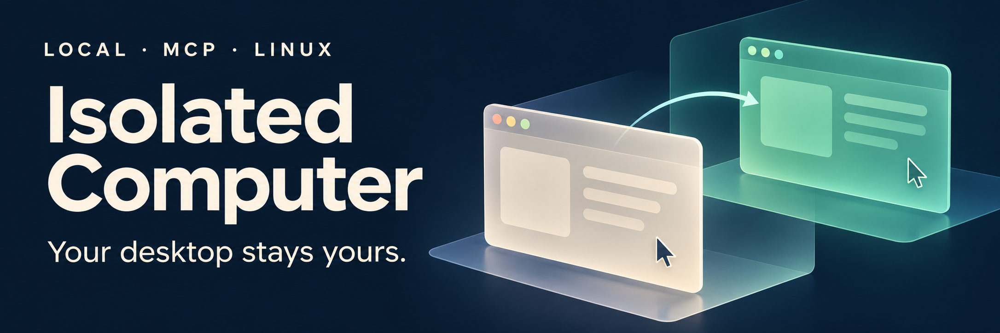
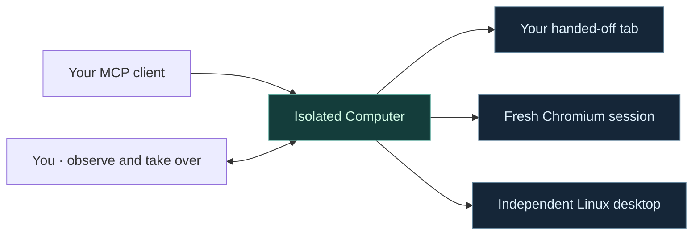

<p align="center">
  
</p>

<p align="center">
  <strong>Let an agent work in the background. Keep your desktop for yourself.</strong><br>
  A local MCP server for live browser handoff, independent Linux apps, and human takeover.
</p>

<p align="center">
  <a href="LICENSE"></a>
  <a href="#quick-start"></a>
  <a href="#run-independent-linux-applications"></a>
</p>

<p align="center">
  <a href="#how-it-works">How it works</a> ·
  <a href="#quick-start">Quick start</a> ·
  <a href="#documentation">Documentation</a> ·
  <a href="GUIDE.zh-CN.md">中文指南</a>
</p>

## Your work, uninterrupted

Sharing a computer with an agent should not mean giving up your mouse. Isolated Computer gives the agent a place to work while you stay in control: hand over a browser tab you have already started, open a fresh browser session, or run native apps in a separate Linux desktop.

**Keep the context.** Continue in the same live tab, with its draft content and page state intact.

**Keep your focus.** Run native applications in an independent display with its own input and session.

**Stay involved.** Observe the workspace, pause the agent, and take over when you need to.

Your MCP client supplies the agent. Isolated Computer supplies the tools; it does not run a model or require an additional model API key.

## How it works

| Start with… | Use | The agent works in… |
|---|---|---|
| A page you have already opened | **Live tab handoff** · `handoff_*` | The same tab, explicitly handed over through the extension. |
| A new web task | **Fresh browser** · `browser_*` | A separate headless Chromium session. |
| A native Linux application | **Independent desktop** · `desktop_*` | A managed Xvfb display with a private D-Bus session. |



### Accessibility first, screenshots when needed

The agent reads structured controls and acts on their references. Chrome uses its native accessibility tree, Linux apps use AT-SPI, and Firefox uses a DOM adapter. Screenshots are available on demand; the independent desktop also supports pixel input for controls that need it.

### Human control, built in

The desktop viewer pauses agent input before giving you exclusive keyboard and mouse control. Hand it back to resume the task. If the viewer disconnects or loses focus during takeover, the agent stays paused.

## Quick start

You need **Node.js 22+** and an **MCP-compatible client**. The native desktop workflow also requires **Linux** and the system packages listed below.

```bash
git clone https://github.com/zhuzccn-rgb/isolated-computer.git
cd isolated-computer
npx pnpm@11.25.0 install --frozen-lockfile
node scripts/build-extensions.mjs
node scripts/print-config.mjs json
```

Add the printed configuration to your MCP client. It uses the absolute path to `src/server.mjs`. For clients that use TOML, run `node scripts/print-config.mjs toml` instead.

### Continue an existing browser tab

1. **Load the extension.** In Chrome/Edge, load `dist/extensions/chrome/` as an unpacked extension. In Firefox, temporarily load `dist/extensions/firefox/manifest.json` through `about:debugging`.
2. **Connect it.** Ask your MCP client to call `computer_status`, then paste the returned `extensionURL` into the extension's connection settings. This address contains a private session token.
3. **Hand over a tab.** Open the extension on a draft or form you want the agent to continue, and explicitly hand it over.
4. **Give it a task:**

   > Continue this form, preserve what I wrote, and stop before submitting.

5. **Keep working.** Move to another tab or window. Use the extension to take the original tab back whenever you need it.

Live tab handoff uses semantic controls to preserve your window focus. For a control that needs direct interaction, take the tab back through the extension.

### Start a fresh browser task

Install Chromium once, then ask your MCP client to use the `browser_*` tools:

```bash
npx playwright install chromium
```

This download is only needed for fresh headless sessions; live tab handoff uses your existing browser.

### Run independent Linux applications

<details>
<summary><strong>Ubuntu / Debian setup</strong></summary>

Install the desktop components and start the independent session:

```bash
sudo apt install xvfb xclip libxtst6 python3-venv python3-tk python3-gi python3-pil \
  gir1.2-atspi-2.0 gir1.2-gtk-3.0 at-spi2-core dbus-x11 openbox xterm
python3 -m venv --system-site-packages .runtime/venv
.runtime/venv/bin/pip install -r desktop/requirements.txt
.runtime/venv/bin/python desktop/linux_session.py \
  --token-file .runtime/desktop.token --port 8766 \
  --apps-file examples/linux-apps.json
```

In another terminal, generate the MCP configuration with the desktop connection included:

```bash
IC_DESKTOP_URL=http://127.0.0.1:8766 \
IC_DESKTOP_TOKEN_FILE="$PWD/.runtime/desktop.token" \
node scripts/print-config.mjs json
```

Add that output to your MCP client. Choose which apps to launch in [`examples/linux-apps.json`](examples/linux-apps.json). Single-instance apps may need a separate profile to keep their windows in the independent session.

</details>

For a guided GTK practice app and human takeover walkthrough, follow the [Linux demo](ACCEPTANCE.md). After installing the desktop dependencies, start it with:

```bash
bash scripts/demo.sh
```

## Responsible use & privacy

- **Work with permission.** Hand over only pages and applications you are authorized to use. Keep consequential actions within the user's explicit instructions and the service's rules.
- **Confirm before submitting.** Conventional submit controls request human confirmation. Custom AJAX actions still require the agent to follow the user's instructions; this is not a universal submission safeguard.
- **Keep session access private.** Services bind to loopback and use session tokens. Do not publish viewer URLs, token files, browser profiles, or cookies.
- **Understand the isolation.** The Linux workspace separates display, focus, and input. It is not a filesystem or network security sandbox.

## Documentation

| Guide | What you will find |
|---|---|
| [中文使用指南](GUIDE.zh-CN.md) | 安装、浏览器接力、独立桌面与人工接管。 |
| [Scenarios](SCENARIOS.md) | Example workflows and expected behavior. |
| [Linux demo & acceptance](ACCEPTANCE.md) | A hands-on walkthrough for desktop control and takeover. |
| [Validation](VERIFY.md) | Recorded test results, environments, compatibility notes, and reproduction commands. |

<details>
<summary><strong>For contributors</strong></summary>

```text
src/        MCP server, browser channels, ownership, and viewer
extension/  Browser handoff extension
desktop/    Linux session, accessibility, and input bridge
public/     Local observation and takeover interface
scripts/    Configuration, extension builds, and validation
tests/      Integration scenarios and application fixtures
```

Run the unit checks with `npm test`. The complete browser and desktop suite requires Linux and its dependencies; see [VERIFY.md](VERIFY.md) for setup and individual checks.

</details>

---

Created by **Zichen (Arthur) Zhu**, with AI assistance. Licensed under [MIT](LICENSE); third-party dependencies retain their own licenses.
