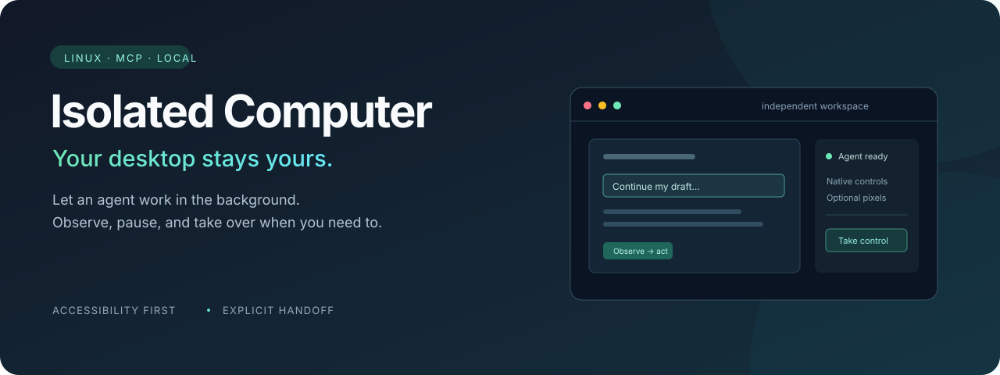
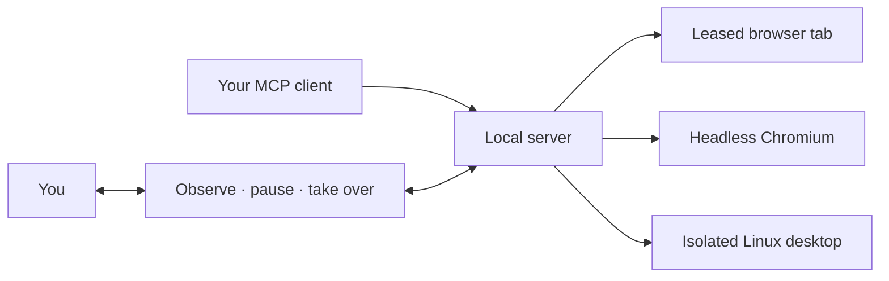

<p align="center"></p>

<p align="center"><strong>Background computer use with a workspace you can observe and take over.</strong><br>Local MCP server · Live browser handoff · Isolated Linux applications</p>

<p align="center"><a href="#how-it-works">How it works</a> · <a href="#quick-start">Quick start</a> · <a href="#validation">Validation</a> · <a href="GUIDE.zh-CN.md">中文使用指南</a></p>

> **Linux development preview.** Tested with real browsers and GTK/GNOME applications in independent sessions. See [validation and limitations](VERIFY.md).

## Why this exists

An agent moving your mouse while you are trying to work is a frustrating way to share a computer. Isolated Computer gives the agent a separate place to work and gives you a way to see what it is doing, pause it, and take control.

For a page you have already started, explicitly hand over that **same tab**. For native applications, launch them inside an **independent Linux display**. The project prioritizes structured accessibility controls; screenshots and pixel input are fallbacks where the selected channel supports them.

## How it works

| You want to… | Channel | What happens |
|---|---|---|
| Continue a half-filled web page | `handoff_*` | An extension leases the existing tab, preserving its live state and original window. |
| Start a fresh web task | `browser_*` | A separate headless Chromium tab handles the task. |
| Work in a native Linux application | `desktop_*` | A managed Xvfb display and private D-Bus session contain its windows and input. |



- **Accessibility first.** Read controls and act on returned references. Chrome exposes native AX; Linux applications use AT-SPI. Firefox uses a labelled DOM fallback.
- **Screenshots on demand.** Observations default to no image. A control with no available native click action returns a screenshot and `needs_pixel_action`; the agent must inspect it and complete the click explicitly.
- **Explicit human control.** The desktop viewer pauses agent input before granting exclusive keyboard and mouse ownership. Normal hand-back resumes the agent; disconnect and loss of focus leave it paused.
- **No extra model service.** The MCP server does not run a model or require an OpenAI API key. Your chosen MCP client supplies the agent.

## Quick start

Use **Linux and Node.js 22+** for the complete desktop workflow. Install JavaScript dependencies with the committed lockfile:

```bash
npx pnpm@11.25.0 install --frozen-lockfile
node scripts/build-extensions.mjs
node scripts/print-config.mjs json
```

The last command prints the local stdio MCP configuration for your client. The entry point is `node /absolute/path/to/isolated-computer/src/server.mjs`.

### Continue an existing browser tab

1. Load `dist/extensions/chrome/` as an unpacked Chrome/Edge extension, or temporarily load `dist/extensions/firefox/manifest.json` in Firefox.
2. Ask the MCP client to call `computer_status`. Copy its `extensionURL` into the extension's connection settings. This URL includes a local access token; keep it private.
3. On a disposable form or draft page, write part of the content, open the extension, and explicitly hand the tab to the agent.
4. Ask: **“Continue this form, preserve what I wrote, and stop before submitting.”**
5. Work in a different tab or window. Use the extension to take the original tab back.

Browser handoff does not require downloading a second Chromium. For fresh headless tasks, install it separately:

```bash
npx playwright install chromium
```

### Run independent Linux applications

On an Ubuntu/Debian system, install the desktop dependencies:

```bash
sudo apt install xvfb xclip libxtst6 python3-venv python3-tk python3-gi python3-pil \
  gir1.2-atspi-2.0 gir1.2-gtk-3.0 at-spi2-core dbus-x11 openbox xterm
python3 -m venv --system-site-packages .runtime/venv
.runtime/venv/bin/pip install -r desktop/requirements.txt
.runtime/venv/bin/python desktop/linux_session.py \
  --token-file .runtime/desktop.token --port 8766 \
  --apps-file examples/linux-apps.json
```

Then, in another terminal:

```bash
IC_DESKTOP_URL=http://127.0.0.1:8766 \
IC_DESKTOP_TOKEN_FILE="$PWD/.runtime/desktop.token" \
node scripts/print-config.mjs json
```

Configure your MCP client with that output. Customize `examples/linux-apps.json` to choose applications for the independent session. Single-instance applications may need a separate profile so they do not forward their launch to an existing host process.

For the GTK practice application and takeover walkthrough, see [Linux acceptance steps](ACCEPTANCE.md). The demo requires the desktop dependencies above:

```bash
bash scripts/demo.sh
```

## The observe–act loop

```text
1. computer_status       → choose the right channel
2. *_observe            → inspect current controls
3. *_controls           → act using returned references
4. *_observe            → verify the actual result
5. handoff_request_user → pause a live tab when finished or blocked
```

A native fallback is **a request for the next action**, not a completed click. Inspect its screenshot, use `desktop_act`, and verify the result before continuing pending actions. Earlier actions in a failed batch may already have happened; observe before retrying.

## Boundaries

| Area | Current scope |
|---|---|
| Linux native applications | AT-SPI `fill` and native `click`/`press`/`activate`; unsupported click actions can request pixel fallback. |
| Existing browser tabs | Semantic operations only. Pixel keyboard/mouse input is rejected because it can activate the user's window. |
| Firefox | Ordinary forms use a DOM adapter. This is a temporary developer extension, not a signed store release. |
| Safari / Windows / macOS | Not validated release targets. Safari needs conversion/signing; Windows UIA and macOS AX are not implemented. |
| Custom widgets and system dialogs | Canvas, trusted-event controls, cross-origin frames, CAPTCHAs and file pickers may require human takeover or specific adapters. |
| Submission protection | Conventional submit controls stop for confirmation; custom AJAX actions still require the agent to follow the user's boundaries. |

The independent Linux desktop isolates **display, focus and input**. It is not a filesystem or network security sandbox. Services bind to loopback and use session tokens. Do not publish viewer URLs, runtime profiles, cookies or token files.

## Validation

The repository includes executable checks for browser handoff, accessibility, isolation and human takeover:

```bash
node --test tests/report-validation.test.mjs
node tests/firefox-scenarios.mjs --concurrent-only

# Broader Linux checks, when needed:
node scripts/verify-all.mjs
```

Firefox tests accept `IC_TEST_FIREFOX_BINARY`, `IC_TEST_GECKODRIVER`, `IC_TEST_OPENBOX`, and optional `IC_TEST_OPENBOX_LIB` / `IC_TEST_OPENBOX_DATA` overrides. `IC_TEST_FIREFOX_VERSION` optionally pins an expected version.

The full verification suite requires Linux and its browser/desktop dependencies. Results and their scope are described in [VERIFY.md](VERIFY.md); release acceptance must record the tested source revision, environment, observed results and remaining limitations. Passing local fixtures does not establish arbitrary website compatibility or all-day reliability.

## Project layout

```text
src/        MCP server, browser channels, ownership and viewer
extension/  Browser handoff extension
desktop/   Linux session, AT-SPI and desktop input bridge
public/     Local observation and takeover interface
scripts/    Configuration, extension builds and validation runner
tests/      Integration scenarios and application fixtures
```

Development preview created by Zichen (Arthur) Zhu with AI assistance. Implementation details, platform boundaries and verification evidence are documented so contributors can inspect the claims.

## License

[MIT](LICENSE). Third-party dependencies retain their own licenses.
